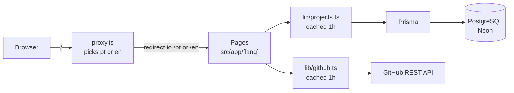
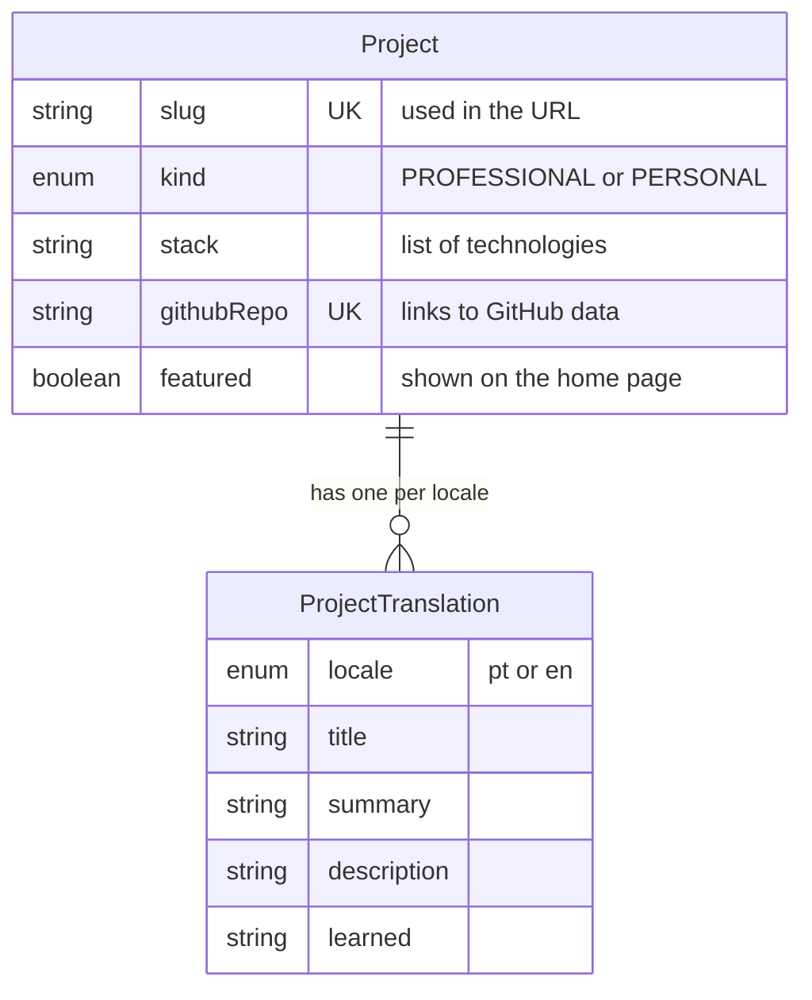

# Leonardo Marinaro — Portfolio

[](https://github.com/LeoMarinaro/portfolio/actions/workflows/ci.yml)

My personal portfolio, in Portuguese and English: who I am, my skills, and the projects I have built, both professional work for clients and personal projects.

**Live site: [leonardomarinaro.vercel.app](https://leonardomarinaro.vercel.app)**

[](https://leonardomarinaro.vercel.app)

## Highlights

- **Two languages** (`/pt` and `/en`) without an i18n library. A proxy picks the visitor's language from the browser's `Accept-Language` header.
- **Projects from two sources**: bilingual write-ups stored in PostgreSQL, merged with live data (stars, languages, last push) from the GitHub API.
- **Fast by default**: pages are pre-rendered at build time and data is cached for an hour. Lighthouse scores 100 in performance, accessibility, best practices, and SEO.
- **Resilient**: if GitHub is down or rate-limited, the site still renders, just without the GitHub data.
- **Light and dark themes** that follow the system setting, with a toggle and no flash of the wrong theme on load.
- **Accessible**: semantic HTML, a skip-to-content link, labelled sections, and WCAG-compliant color contrast.
- **Tested and checked in CI**: unit tests with Vitest; lint, tests, and build run on every push.

## Tech stack

| Area | Tools |
| --- | --- |
| Framework | [Next.js 16](https://nextjs.org) (App Router, Server Components, Cache Components), React 19 |
| Language | TypeScript (strict mode) |
| Styling | Tailwind CSS 4, Geist font |
| Database | PostgreSQL on [Neon](https://neon.tech), [Prisma 7](https://www.prisma.io) ORM |
| External API | GitHub REST API |
| Testing | [Vitest](https://vitest.dev) |
| CI/CD | GitHub Actions (checks), Vercel (deploys every push to `main`) |

## Architecture



1. **`src/proxy.ts`** runs before every request. If the URL has no language prefix, it reads `Accept-Language` and redirects to `/pt` or `/en`.
2. **`src/app/[lang]/`** holds every route. The `[lang]` folder is a dynamic segment, so both languages share the same files. UI text comes from typed JSON dictionaries in `src/i18n/dictionaries/`.
3. **Pages are Server Components.** They run on the server and send ready HTML; only the theme toggle and language switcher run in the browser.
4. **`src/lib/`** is the data layer. Pages never talk to the database or GitHub directly; they call functions like `getFeaturedProjects(locale)`, which use `"use cache"` so the database and the API are queried at most about once an hour.

### Folder structure

```
src/
├── app/[lang]/          Routes: home, /projects, /projects/[slug], 404, Open Graph image
├── components/          UI pieces (header, footer, cards, home sections)
├── i18n/                Supported languages, language detection, dictionaries
├── lib/                 Data access (database, GitHub), formatting, theme
└── proxy.ts             Language redirect
prisma/
├── schema.prisma        Database tables
├── migrations/          Versioned SQL changes
└── seed.ts              Project content (idempotent)
```

### Data model

Each project has one row of shared data and one translation row per language, so adding a language means adding rows, not columns.



## Key decisions

- **i18n without a library.** The site only needs two languages and static text, so the approach from the official Next.js guide (a dynamic `[lang]` segment and JSON dictionaries) was enough, with no extra dependency. The dictionary type comes from `pt.json`, so a key missing from `en.json` fails the build.
- **Database plus GitHub API.** GitHub alone cannot hold bilingual write-ups or professional projects whose code belongs to clients. The database stores what I write; GitHub provides data that changes on its own, like stars.
- **Caching for an hour.** Without a token, the GitHub API allows 60 requests per hour. Caching keeps the site fast and well under that limit, at the cost of content edits taking up to an hour to appear.
- **Testing pure functions.** Vitest does not support async Server Components, so unit tests cover the logic with tricky cases: language detection and the language-percentage chart.

## Running locally

Requirements: Node.js 24 and a PostgreSQL database (a free [Neon](https://neon.tech) database works).

```bash
# 1. Install dependencies (also generates the Prisma client)
npm install

# 2. Configure environment variables
cp .env.example .env    # then fill in the values

# 3. Create the tables and load the project content
npx prisma migrate deploy
npx prisma db seed

# 4. Start the development server
npm run dev
```

Open [http://localhost:3000](http://localhost:3000). It redirects to `/pt` or `/en` based on your browser language.

### Environment variables

| Name | Required | Purpose |
| --- | --- | --- |
| `DATABASE_URL` | Yes | Pooled PostgreSQL connection used by the app |
| `DATABASE_URL_UNPOOLED` | For migrations | Direct connection used by `prisma migrate` |
| `GITHUB_TOKEN` | No | Raises the GitHub API rate limit from 60 to 5,000 requests per hour |

### Scripts

| Command | What it does |
| --- | --- |
| `npm run dev` | Development server with hot reload |
| `npm run build` | Production build (needs `DATABASE_URL`) |
| `npm start` | Serves the production build |
| `npm run lint` | ESLint |
| `npm test` | Vitest (watch mode locally, single run in CI) |
| `npx prisma db seed` | Inserts or updates the projects in `prisma/seed.ts` |

## Adding a project

- **With a full write-up:** add it to `prisma/seed.ts` with text in both languages, then run `npx prisma db seed`.
- **GitHub only:** add the `portfolio` topic to the repository on GitHub. It appears in the "On GitHub" section of `/projects` within an hour.

## Deployment

Every push to `main` triggers two things:

1. **GitHub Actions** runs lint, tests, and a production build on a clean machine (see [`.github/workflows/ci.yml`](.github/workflows/ci.yml)). `DATABASE_URL` is stored as a repository secret.
2. **Vercel** builds and publishes the site. Environment variables are set in the Vercel project settings.

## Contact

[LinkedIn](https://www.linkedin.com/in/leonardomarinaro) · [GitHub](https://github.com/LeoMarinaro)
